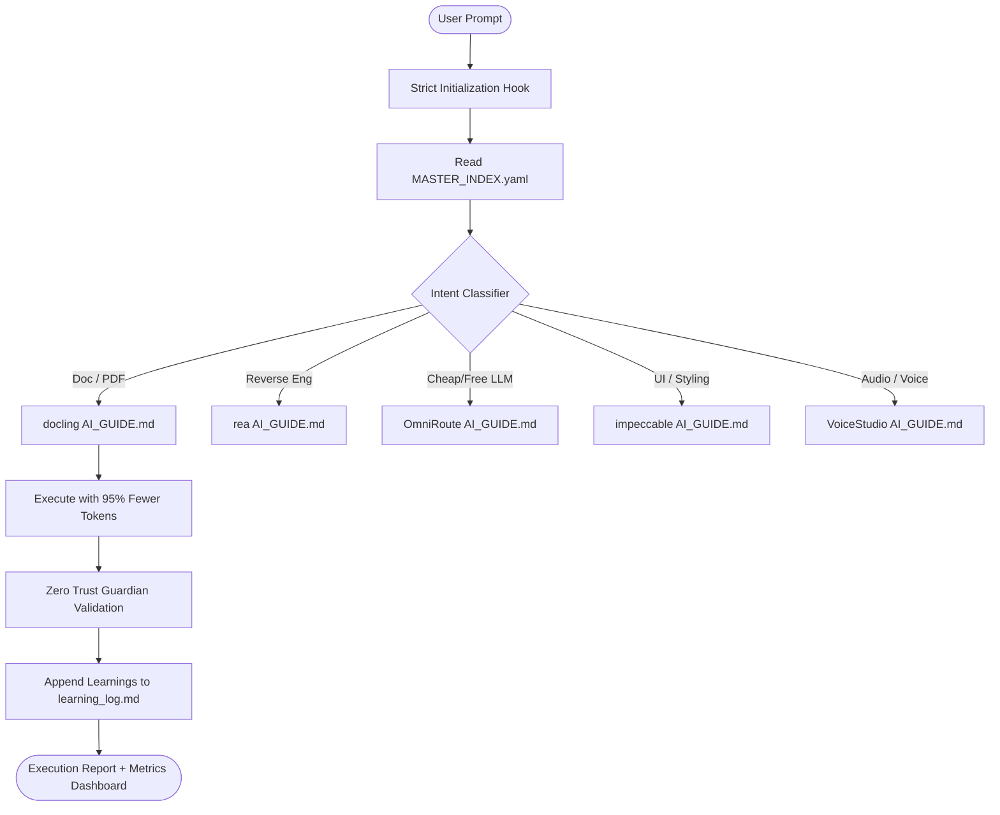

# 🧠 Universal Second Brain — Autonomous AI Governance, Memory & Tools Hub

[](LICENSE)
[]()
[]()
[]()
[]()
[-purple.svg)]()

> **The definitive operating system for AI-assisted development.**  
> A persistent, local-first central brain that coordinates multiple AI models, provides 25 battle-tested specialized toolkits, eliminates token waste by up to 95%, enforces Zero Trust architectural governance, and visualizes system relationships through an interactive Knowledge Graph dashboard.

---

## 🌟 Why Universal Second Brain?

Modern AI development assistants (Claude Code, Gemini CLI, Google Antigravity, Cursor, Ollama, Codex) lose context between sessions, repeatedly re-invent utilities from scratch, hallucinate codebase dependencies, and waste millions of costly tokens scanning huge repositories.

**Universal Second Brain** solves this fundamentally by providing:
1. **Semantic Pre-Tool Contracts (`AI_GUIDE.md`):** Every single tool and repository has a standardized, token-efficient semantic guide. AI agents read only 10-30 lines instead of scanning thousands of source code files.
2. **Cold Snapshot Resilience:** All 25 repositories are cloned locally with autonomous fallback. Even if an upstream GitHub repository is deleted or made private, your local tool remains 100% operational and locked.
3. **Zero Trust Execution Guardian (`core/governanca/`):** An automated runtime barrier that intercepts AI actions and halts execution if architectural rules, directory structures, or documentation guidelines are violated.
4. **Interactive 60FPS Knowledge Graph & Telemetry Dashboard:** A standalone, responsive web interface to inspect dependencies visually, browse tools, trigger syncs, and monitor token savings in real time.
5. **Cross-Session Memory & Auto-Evolution:** Automatically logs technical decisions, user preferences, and bug solutions in append-only storage, feeding continuous learning back into future sessions.

---

## 🗺️ System Architecture & Taxonomy

```text
C:\Users\USER\.second_brain\
├── README.md                      # Primary open-source documentation (English)
├── README_PT.md                   # Documentação nativa em português
├── projeto_second_brain.md         # Zero Trust Master Architecture Document
├── MASTER_INDEX.yaml               # P0 semantic entry point & intent router
├── global_rules.md                 # Universal non-negotiable rules for AI agents
├── active_behavior_rules.yaml      # Fingerprinted behavioral enforcement
├── behavioral_patterns.yaml        # Developer preferences & architectural constraints
│
├── core/                          # Governance & Security Core
│   └── governanca/                # Execution Guardian, rule validator & doc reader
│
├── repos/                         # The 25 Integrated Specialized Toolkits
│   ├── media_processing/          # Neural TTS, video editing, diagrams & screen parsers
│   ├── dev_reverse_engineering/   # Decompilation, TDD frameworks, prompts & ML
│   ├── ui_ux_design/              # Anti-slop premium design guidelines
│   ├── orchestration_governance/  # Multi-agent swarms, message bus & 5P framework
│   ├── routing_gateways/          # Cost-zero LLM routers & free AI aggregators
│   ├── memory_rag_graphs/         # Cross-session memory & code dependency graphs
│   ├── document_web_parsers/      # Multimodal PDF extraction & ad-free scraping
│   └── cloud_security_b2b/        # OWASP audits, Tencent cloud & 250+ SaaS connectors
│
├── knowledge/                     # Persistent Knowledge & Catalogs
│   ├── installed_assets_catalog.md# Master unified index of all tools, agents & skills
│   ├── project_decisions.md        # Architectural decision records (ADRs)
│   ├── learning_log.md             # Autonomous continuous learning timeline
│   └── rpa_database_schema_audit.md# Relational database schema audit
│
├── scripts/                       # Automation & Background Engines
│   ├── repo_sync_engine.py         # Autonomous auto-sync & Cold Snapshot engine
│   ├── schedule_auto_sync.ps1      # Windows Task Scheduler automation
│   ├── export_frontend_hub_data.py # Data pipeline for the interactive dashboard
│   ├── generate_ai_guides.py       # Universal AI_GUIDE.md generator
│   └── usage_metrics.py            # Real-time token telemetry & dashboard exporter
│
├── frontend/                      # Real-Time Observability & Knowledge Graph
│   ├── index.html                  # Responsive dashboard interface
│   ├── app.js                      # Canvas 60fps graph simulation & tool explorer
│   ├── style.css                   # Premium dark-mode design system
│   └── start_dashboard.ps1         # One-click dashboard launcher
│
├── backend/                       # Local AI Services & Engines
│   └── aurelio/                   # Autonomous local AI agent powered by Ollama
│
├── projects/                      # Live Project Contexts & Maps
│   ├── rpa_context.md              # Enterprise RPA architecture context
│   └── wrpe_recorder_context.md    # High-fidelity interaction recorder context
│
└── .agents/                       # AG Kit Multi-Agent Framework
    ├── agent/                     # 20 Specialist agent personas
    ├── skills/                    # 47 Engineering manuals and workflows
    ├── workflows/                 # 13 Slash-command workflows (/plan, /debug...)
    └── scripts/                   # Isolated empirical test suites
```

---

## 🗄️ The 25 Integrated Toolkits (Hub Catalog)

The Second Brain includes 25 specialized open-source tools organized into 8 functional categories:

| Repository | Category | Upstream Source | Primary Capability |
| :--- | :--- | :--- | :--- |
| **VoiceStudio** | `media_processing` | [debpalash/VoiceStudio](https://github.com/debpalash/VoiceStudio) | Neural TTS, voice cloning (F5-TTS, CosyVoice) and audio studio. |
| **editonny** | `media_processing` | [soumatheusgomes/editonny](https://github.com/soumatheusgomes/editonny) | AI-powered programmatic video/image editing and smart cutouts. |
| **diagram-design** | `media_processing` | [cathrynlavery/diagram-design](https://github.com/cathrynlavery/diagram-design) | Standardized blueprints for Mermaid, ASCII and visual system architecture. |
| **paperclip** | `media_processing` | [paperclipai/paperclip](https://github.com/paperclipai/paperclip) | Visual screen extractor and screenshot-to-code transcriber. |
| **rea** | `dev_reverse_engineering`| [morluto/rea](https://github.com/morluto/rea) | Reverse engineering, binary inspection (.exe/.dll) and LLM-assisted decompilation. |
| **ECC** | `dev_reverse_engineering`| [affaan-m/ECC](https://github.com/affaan-m/ECC) | Everything Claude Code: comprehensive prompts, CLI flags and automation scripts. |
| **vibe-coding-toolkit** | `dev_reverse_engineering`| [soumatheusgomes/vibe-coding-toolkit](https://github.com/soumatheusgomes/vibe-coding-toolkit) | Ultra-fast scaffolding snippets and agile prototyping templates. |
| **andrej-karpathy-skills** | `dev_reverse_engineering`| [multica-ai/andrej-karpathy-skills](https://github.com/multica-ai/andrej-karpathy-skills) | Essential Deep Learning, nanoGPT implementations and pure transformer patterns. |
| **superpowers** | `dev_reverse_engineering`| [obra/superpowers](https://github.com/obra/superpowers) | Disciplined TDD workflows, systematic debugging and code hardening. |
| **impeccable** | `ui_ux_design` | [pbakaus/impeccable](https://github.com/pbakaus/impeccable) | World-class anti-slop design tokens, micro-interactions and premium typography. |
| **ruflo** | `orchestration_governance`| [ruvnet/ruflo](https://github.com/ruvnet/ruflo) | High-speed multi-agent runtime with asynchronous message bus. |
| **agentville** | `orchestration_governance`| [soumatheusgomes/agentville](https://github.com/soumatheusgomes/agentville) | Autonomous multi-agent simulation with diverse personas and collaboration. |
| **framework-5p** | `orchestration_governance`| [soumatheusgomes/framework-5p](https://github.com/soumatheusgomes/framework-5p) | 5P Framework (Purpose, People, Process, Platform, Performance) for project governance. |
| **claude-plugins-official** | `orchestration_governance`| [anthropics/claude-plugins-official](https://github.com/anthropics/claude-plugins-official) | Official Anthropic AI plugin manifests, schemas, and extension specs. |
| **OmniRoute** | `routing_gateways` | [diegosouzapw/OmniRoute](https://github.com/diegosouzapw/OmniRoute) | Smart LLM router with cost-based load balancing and automatic free fallbacks. |
| **freellmapi** | `routing_gateways` | [tashfeenahmed/freellmapi](https://github.com/tashfeenahmed/freellmapi) | Unified aggregator and OpenAI-compatible proxy for free public LLM endpoints. |
| **claude-mem** | `memory_rag_graphs` | [thedotmack/claude-mem](https://github.com/thedotmack/claude-mem) | Continuous cross-session episodic memory and context retention for AI agents. |
| **hindsight** | `memory_rag_graphs` | [vectorize-io/hindsight](https://github.com/vectorize-io/hindsight) | Post-execution reflection framework to evaluate RAG context and prevent hallucinations. |
| **graphify** | `memory_rag_graphs` | [Graphify-Labs/graphify](https://github.com/Graphify-Labs/graphify) | Transforms source code and relational databases into searchable Knowledge Graphs. |
| **docling** | `document_web_parsers` | [docling-project/docling](https://github.com/docling-project/docling) | IBM Research state-of-the-art multimodal parser for complex PDFs and tables to Markdown. |
| **ponytail** | `document_web_parsers` | [DietrichGebert/ponytail](https://github.com/DietrichGebert/ponytail) | Lightweight headless web scraper that extracts clean Markdown without ad bloat. |
| **scientific-agent-skills** | `document_web_parsers` | [K-Dense-AI/scientific-agent-skills](https://github.com/K-Dense-AI/scientific-agent-skills) | Exact mathematical solvers and research paper search tools (arXiv/PubMed). |
| **security-audit-skill** | `cloud_security_b2b` | [cloudflare/security-audit-skill](https://github.com/cloudflare/security-audit-skill) | Cloudflare static security analysis: OWASP Top 10 vulnerabilities & exposed secrets. |
| **Octop** | `cloud_security_b2b` | [TencentCloud/Octop](https://github.com/TencentCloud/Octop) | Unified Tencent Cloud infrastructure-as-code automation and multi-cloud manager. |
| **nango** | `cloud_security_b2b` | [NangoHQ/nango](https://github.com/NangoHQ/nango) | Unified open-source integration platform for 250+ SaaS APIs with OAuth handling. |

---

## 🖥️ The Real-Time Frontend & Knowledge Graph

The Second Brain features a local dashboard built with modern HTML5, Vanilla CSS, and Canvas:

### 1. Interactive Knowledge Graph Visualizer (`/frontend/index.html#graphs`)
- **Physics Simulation (60 FPS):** Visualizes the living relationships between the **Second Brain Core**, **8 Taxonomy Categories**, **25 Toolkits**, and **Active Projects** (RPA, WRPE, Aurelio).
- **Interactive Node Inspector:** Click or hover any node on the canvas to see its description, direct connection links, category tags, and trigger words.
- **Direct Manual Launcher:** Click directly from any repository node in the graph to open its full `AI_GUIDE.md`.
- **Physics Control:** Pause gravity or re-center the canvas at any time.

### 2. Hub Repositories Explorer (`/frontend/index.html#repos`)
- **Live Filtering:** Instant filtering by category pills (Media, Reverse Eng, UI/UX, Orchestration, Gateways, Memory, Parsers, Security).
- **Real-Time Search:** Search tools by name, functionality, or trigger intent.
- **Contract Modal:** One-click modal view of each tool's `AI_GUIDE.md` instructions, CLI commands, and Python code snippets.
- **Cold Snapshot Indicator:** Green badge for `OK` and amber badge for `COLD SNAPSHOT` protection status.

### 3. Telemetry & Observability
- Tracks **Total Interactions**, **Tokens Spent vs. Saved**, **Execution Duration**, and **Files Read vs. Avoided**.
- 30-Day trend graphs and historical session auditor.

---

## 🚀 Quickstart: Setting Up on Your Machine

### Prerequisites
- **Git** (`git --version` >= 2.30)
- **Python 3.10+** (`python --version`)
- **PowerShell** (Windows) or **Bash** (macOS/Linux)

### Step 1: Clone the Repository
```bash
git clone https://github.com/your-username/second_brain.git ~/.second_brain
cd ~/.second_brain
```

### Step 2: Install Python Dependencies
```bash
python -m pip install pyyaml
```

### Step 3: Run the Auto-Sync Engine (Clones & Validates all 25 Repos)
```bash
python scripts/repo_sync_engine.py
```
*The engine will clone all 25 repositories with Cold Snapshot protection, generate the `AI_GUIDE.md` semantic contracts, and build the unified catalog.*

### Step 4: Export Dashboard Data
```bash
python scripts/export_frontend_hub_data.py
```

### Step 5: Launch the Visual Dashboard
On **Windows (PowerShell)**:
```powershell
.\frontend\start_dashboard.ps1
```
On **macOS / Linux**:
```bash
python scripts/server.py 8765
# Open http://localhost:8765/frontend/index.html in your browser
```

---

## 🔄 Automated Background Auto-Sync & Cold Snapshot

To ensure your Second Brain always stays up-to-date without disrupting your work:

### Schedule Daily Sincronization (Windows Task Scheduler)
```powershell
.\scripts\schedule_auto_sync.ps1 -Install
```
- Runs quietly every day at **03:00 AM**.
- Executes `git remote update` and `git pull --ff-only` on all 25 repositories.
- **Cold Snapshot Protection:** If any repository returns HTTP 404 (deleted) or HTTP 403 (privatized), the engine **preserves your local copy** without deleting a single file, marks the repository as `COLD_SNAPSHOT_LOCKED`, and logs the event.

To check sync status at any time:
```bash
python scripts/repo_sync_engine.py --status
```

---

## 🤖 How AI Agents Consume the Second Brain

Any AI agent (Claude Code, Gemini CLI, Google Antigravity, Ollama, OpenAI) connecting to this workspace follows a strict 3-step sequence:



1. **P0 Gate:** The agent reads [MASTER_INDEX.yaml](file:///C:/Users/USER/.second_brain/MASTER_INDEX.yaml) to locate relevant capabilities.
2. **Pre-Tool Contract:** The agent loads only the specific tool's `AI_GUIDE.md` instead of analyzing entire repositories.
3. **Execution Guardian:** All changes are checked against [validador_regras.py](file:///C:/Users/USER/.second_brain/core/governanca/validador_regras.py) before completion.
4. **Autonomous Feedback:** Decisions are saved to `knowledge/project_decisions.md` and telemetry is dispatched to `scripts/usage_metrics.py`.

---

## 🛡️ Zero Trust Governance Standard

Every directory and subfolder across the entire Second Brain adheres to the **Zero Trust Documentation Standard**:
- Every directory contains a dedicated `*_nome.md` (e.g. `scripts_second_brain.md`, `backend_second_brain.md`).
- Every document begins with the mandatory governance header block:
  ```markdown
  > 🚨 **REGRA DE GOVERNANÇA GLOBAL — LEITURA OBRIGATÓRIA ANTES DE QUALQUER COMMIT/MODIFICAÇÃO**
  > 1. ✅ TODO subdiretório deste projeto possui um arquivo *_nome.md.
  > 2. ✅ SEMPRE que alterar um arquivo, você DEVE atualizar o .md daquela subpasta.
  > 3. ✅ Se a mudança for estrutural, projeto_second_brain.md deve ser atualizado.
  > ❌ CÓDIGO SEM DOCUMENTAÇÃO ATUALIZADA SERÁ CONSIDERADO INVÁLIDO.
  ```
- Any modification made without updating the corresponding `.md` history is automatically flagged as invalid by the **Execution Guardian** (`core/governanca/guardiao_execucao.py`).

---

## 🧪 Empirical Verification Suite

Run the isolated validation test at any time to verify that all 25 repositories, governance rules, and sync engines are intact:

```bash
python .agents/scripts/test_physical_implementation.py
python .agents/scripts/test_second_brain_governance.py
```

Expected output:
```text
=================================================================
🎯 TODOS OS 7 TESTES EMPÍRICOS DE VALIDAÇÃO PASSARAM COM SUCESSO!
🎯 TODOS OS 5 TESTES DE GOVERNANÇA PASSARAM COM SUCESSO!
=================================================================
```

---

## 📄 License

Distributed under the **MIT License**. See `LICENSE` for more information.

---

## 👤 Author & Maintainer

- **Developer:** USER
- **Architecture & System Design:** Universal Second Brain Core v2.0
- **Supported Agents:** Google Antigravity, Claude Code, Gemini CLI, Ollama, OpenAI, VS Code & Cursor IDE
